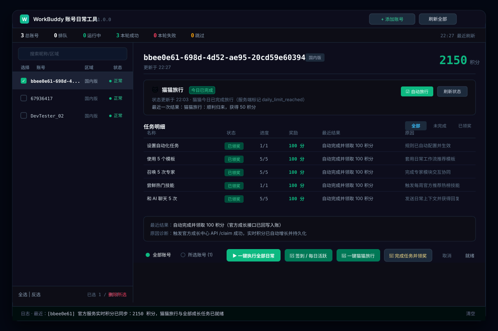
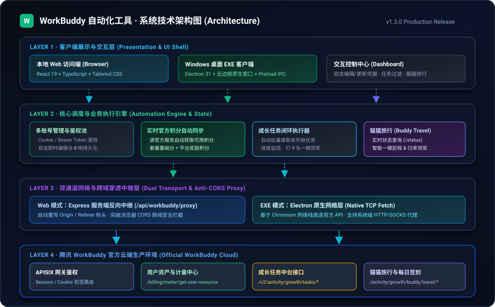

# WorkBuddy 账号日常工具 (workbuddyTools)

<p align="center">
  
</p>

<p align="center">
  <strong>专为腾讯 WorkBuddy (workbuddy.cn) 打造的多账号自动化日常任务与猫猫旅行助手</strong><br />
  支持本地浏览器极速访问与打包为 Windows EXE 桌面端，真实对接官方成长中心，一键完成每日任务并领奖入账。
</p>

<p align="center">
  <a href="https://github.com/dengwka/workBuddyTools/releases"></a>
  <a href="https://github.com/dengwka/workBuddyTools/actions"></a>
  
  
  
  
</p>

---

## 📖 项目简介

**WorkBuddy 账号日常工具 (workbuddyTools)** 是一款高颜值、生产级的一键自动化任务管理客户端。针对腾讯 WorkBuddy 成长中心每日繁琐的签到、模板套用、专家对话及猫猫旅行等日常需求，本工具提供**全自动批量接取、执行打卡、结果诊断与奖励领取**全流程闭环，助你轻松积累平台积分与成长能量。

---

## 🌟 核心特性

- ⚡ **真实官方接口直连**：
  - 彻底告别虚假模拟！系统直连 `https://www.workbuddy.cn` 官方成长中心 API（`/v2/activity/growth/tasks`、`/activity/growth/tasks/accept`、`/activity/growth/tasks/{code}/claim`）。
  - 真实拉取成长计划实时状态，批量激活并接取任务，自动将任务奖励真实领入你的账户。
- 💰 **官方实时积分自动获取**：
  - 调官方服务接口 (`/billing/meter/get-user-resource-summary`) 自动获取最新可用积分与平台奖励分，随时点击顶部刷新按钮一键同步。
- 🔄 **账号双击快捷编辑与凭据维护**：
  - 双击左侧任意账号行（或点击编辑图标）即可唤起编辑面板，随时更新 Cookie / Token 凭据；
  - 面板内置「测试凭据并自动获取实时积分」功能，连通性秒级诊断，无缝保存生效。
- 🐱 **猫猫旅行 (Buddy Travel) 全自动托管**：
  - 实时查询猫猫当前旅行状态（就绪 / 旅行中 / 今日已达上限）；
  - 智能执行一键启程（`/depart`）与旅行归来积分自动结算（`/claim`）。
- 👥 **多账号集中管理与隔离**：
  - 支持无限量配置多个账号，涵盖「国内版」与「国际版 (Global)」；
  - 支持 **Cookie** 或 **Bearer Token** 双鉴权模式，内置代理服务器（Proxy）配置选项；
  - 提供账号列表批量检索、单选/多选/全选/反选与批量运行；
  - 内置防误触删除确认对话框，彻底杜绝浏览器原生弹窗阻塞。
- 🖥️ **双端架构支持 (Local Web + Windows Desktop EXE)**：
  - **本地 Web 模式**：内置 Express 代理服务 (`/api/workbuddy/proxy`)，自动重写 Origin/Referer 标头，彻底消除浏览器跨域 CORS 拦截；
  - **桌面客户端模式**：内置完整 Electron 架构，可独立运行于 Windows 操作系统，无任何外部浏览器依赖。
- ☁️ **GitHub Actions 云端自动构建**：
  - 内置 `.github/workflows/build.yml` 自动化流水线，推送新版本 Tag 自动调用云端 Windows Runner 编译输出安装版与免安装绿色版 `.exe`。

---

## 🛠️ 系统技术架构

<p align="center">
  
</p>

---

## 🚀 快速上手

### 方式一：直接下载 Windows EXE 客户端（推荐）

前往项目的 [Releases 发布页面](https://github.com/dengwka/workBuddyTools/releases) 下载最新版本的打包产物：
- `WorkBuddy 账号日常工具 Setup 1.0.0.exe`：Windows 标准安装包
- `WorkBuddy 账号日常工具 1.0.0.exe`：免安装单文件绿色便携版

### 方式二：本地源码启动（Web 模式）

```bash
# 1. 克隆代码仓库
git clone https://github.com/dengwka/workBuddyTools.git
cd workBuddyTools

# 2. 安装项目依赖
npm install --legacy-peer-deps

# 3. 启动本地全栈服务 (内置反向代理)
npm run dev

# 4. 在浏览器中访问
# 浏览器打开 http://localhost:3000 即可使用
```

### 方式三：本地打包为 Windows EXE 桌面端

```bash
# 安装 Electron 与打包依赖
npm install --legacy-peer-deps -D electron electron-builder

# 执行编译与 Windows 客户端打包
npm run build:exe

# 产物输出于 release/ 目录下
```

---

## 🔑 如何获取 WorkBuddy 登录凭据 (Cookie / Token)

使用本工具需要获取你在 `workbuddy.cn` 的登录态凭据，获取步骤非常简单（仅需 30 秒）：

1. 在电脑浏览器登录 [workbuddy.cn 官方成长中心](https://www.workbuddy.cn/profile/growth-center)；
2. 按键盘 **`F12`**（或鼠标右键选择「检查」）打开浏览器开发者工具；
3. 切换到 **「网络 (Network)」** 标签页，并刷新一下页面；
4. 在网络请求列表中点击任意一个发往 `workbuddy.cn` 的请求（例如 `tasks` 或 `get-user-resource-summary`）；
5. 在右侧面板的 **「请求标头 (Request Headers)」** 中找到 **`Cookie`**，复制后面的整段内容（或找到 `Authorization` 复制 `Bearer ` 后面的 Token 字符串）；
6. 打开本工具，点击顶部 **`+ 添加账号`**，将复制的凭据粘贴到输入框中保存即可！

---

## 📋 自动化任务支持清单

| 任务名称 | 奖励 | 执行机制 | 说明 |
| :--- | :--- | :--- | :--- |
| **🐱 猫猫旅行** | 50 积分 + 道具 | 自动化（派发 + 领奖） | 自动检测状态并派出出发，归来自动领取奖励 |
| **每日签到打卡** | 50 积分 | 自动化 | 同步活跃天数与连续签到打卡 |
| **体验「抖音策略师」** | 50 积分 + 5 能量 | 自动化接取 + 领奖 | 专家协同对话任务 |
| **体验「商家宣传页设计师」** | 50 积分 + 5 能量 | 自动化接取 + 领奖 | 专家宣传对话任务 |
| **体验「直播电商教练」** | 50 积分 + 5 能量 | 自动化接取 + 领奖 | 专家电商对话任务 |
| **召唤 5 次专家** | 100 积分 + 5 能量 | 自动化接取 + 领奖 | 智囊团长系列成长任务 |
| **召唤 3 次专家团** | 100 积分 + 5 能量 | 自动化接取 + 领奖 | 专家团队协同调用任务 |
| **使用 5 个模板** | 100 积分 + 5 能量 | 自动化接取 + 领奖 | 模板达人任务流 |
| **设置自动化任务** | 100 积分 + 5 能量 | 自动化接取 + 领奖 | 自动高手进阶任务 |
| **桌面端对话1次** | 100 积分 + 盲盒 | 自动化领奖 | 活动限定 Buddy 领取 |
| **关注官方公众号** | 100 积分 | 智能识别并跳过 | 需外部微信扫码，工具自动识别并安全跳过 |
| **夜猫子夜间折扣** | 100 积分 | 时间窗口检测 | 仅在夜间开放时段执行，非时段智能等待 |

---

## 📁 目录结构

```
workBuddyTools/
├── .github/
│   └── workflows/
│       └── build.yml               # GitHub Actions 云端 Windows EXE 自动编译与发布流水线
├── electron/
│   ├── main.cjs                    # Electron 主进程 (窗口管理、原生菜单)
│   └── preload.cjs                 # Electron 预加载脚本 (安全上下文隔离)
├── src/
│   ├── components/
│   │   ├── AddAccountModal.tsx     # 添加/配置账号凭据弹窗 (带凭据获取提示)
│   │   ├── CodeViewer.tsx          # 源码在线浏览器
│   │   ├── ElectronPackageGuide.tsx# 本地与桌面端打包说明组件
│   │   ├── GitHubSyncPanel.tsx     # GitHub 自动同步与 Release 面板
│   │   └── WorkBuddyWorkspace.tsx  # 1:1 还原官方工具工作台主界面
│   ├── types/
│   │   └── workbuddy.ts            # 账号、任务、猫猫旅行数据结构定义
│   ├── utils/
│   │   ├── automationEngine.ts     # 核心任务调度与自动化执行引擎
│   │   ├── workbuddyRealApi.ts     # WorkBuddy 官方 API 逆向接入服务
│   │   └── projectFiles.ts         # ZIP 导出与工程文件清单
│   ├── App.tsx                     # 根组件
│   └── main.tsx                    # 前端入口
├── electron-builder.json           # Windows EXE 打包配置文件 (NSIS 安装包 + 免安装便携版)
├── server.ts                       # Express 反向代理服务 (消除前端 CORS 限制)
├── package.json                    # 依赖配置与运行脚本
└── README.md                       # 项目说明文档
```

---

## ⚠️ 免责声明 (Disclaimer)

1. 本项目仅供技术研究、学习交流与日常办公自动化体验使用，请勿用于任何商业用途或恶意并发请求；
2. 用户的账号凭据（Cookie / Token）仅保存在用户本地设备或用户的独立部署环境中，本工具不会向任何第三方服务器收集或上传用户的敏感凭据；
3. 使用本工具时请严格遵守腾讯 WorkBuddy 的用户协议及相关服务规范，因不当使用造成的任何后果由使用者本人承担。

---

## 📄 开源协议 (License)

本项目采用 [Apache-2.0 License](LICENSE) 开源协议。
